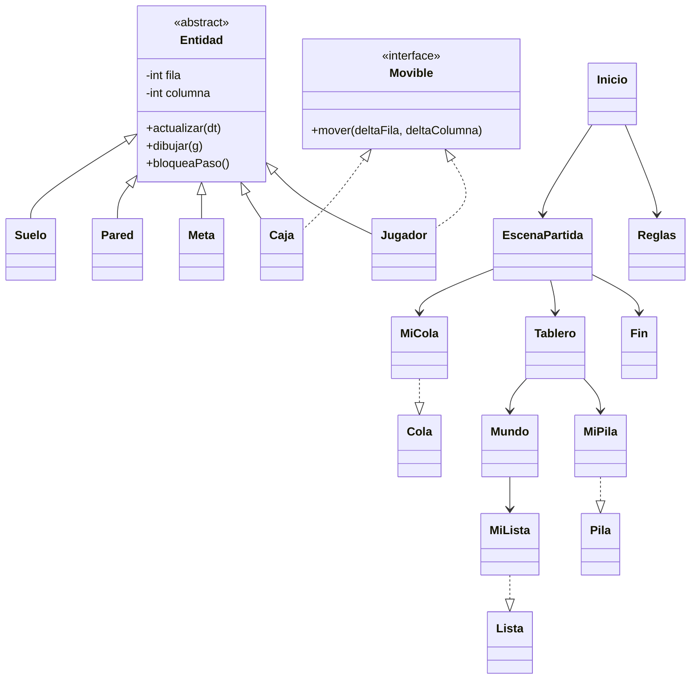

# Diagrama de clases

Las interfaces `Lista`, `Pila` y `Cola` pertenecen al kit; sus implementaciones son propias. `Lista` conserva `Iterable<T>` porque `juego.reglas.Mundo` usa `iterator()` y `for-each`, tal como en el kit original.
